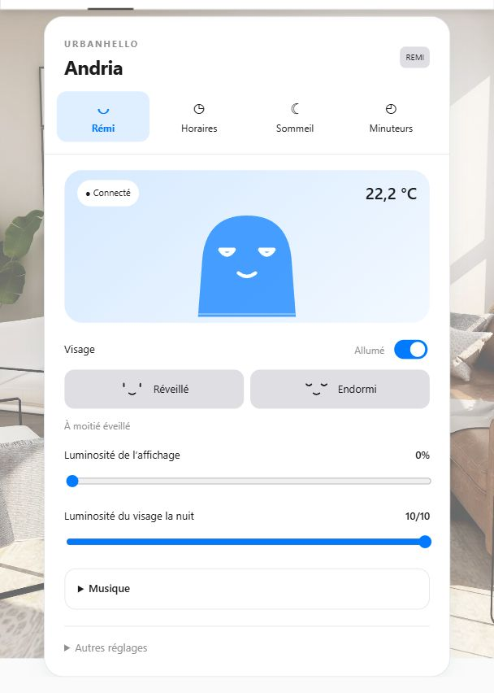

  

<h1 align="center">UrbanHello REMI for Home Assistant</h1>

  
  
  
  

  
  
  
  
  
  

  Your REMI, its schedules and its sleep reports in one dashboard card. 
  Everyday controls in English or French, following your Home Assistant language.

**0.5.2 is the current stable release.** Requires Home Assistant **2026.11.0 or newer**, a REMI configured in the UrbanHello app and internet access.

## Your REMI dashboard

   
  Actual Home Assistant dashboard · French interface · Light theme

## What you can do

- **Control the face and brightness:** on/off, Awake/Sleepy and separate display/night brightness.
- **Manage schedules:** see their times, toggle them and edit their settings.
- **Follow the room and sleep:** decimal temperature, dated sleep reports and environmental charts.
- **Access music and timers:** a collapsible music panel and up to five stored timer profiles.

The card updates with the integration. Existing entity IDs and dashboard configurations are preserved. [Features and limitations →](docs/usage.md)

## Quick installation

1. In **Settings → Marketplace → Add from link**, add `https://github.com/Mins95/ha-remi` and install **Remi (Mins95)**.
2. Restart Home Assistant, then add **Remi** under **Settings → Devices & services** using your UrbanHello account.
3. Add **REMI** from your dashboard's card picker. No separate card download or YAML is needed.

**Already installed?** Update to **0.5.2**, restart Home Assistant and reload the browser or Companion app. Keep your existing integration and card.

[HACS, manual installation and repository changes →](docs/usage.md#installation)

## Documentation

| Guide | Contents |
| --- | --- |
| [Dashboard card](docs/card.md) | Setup, tabs and everyday controls |
| [Usage](docs/usage.md) | Installation, entities, actions and examples |
| [Upgrading](docs/usage.md#upgrading) | Migration from older versions and betas |
| [Troubleshooting](docs/usage.md#troubleshooting) | Connection, firmware and feature limits |
| [Development](docs/development.md) | Test environment, contributions and releases |
| [Changelog](CHANGELOG.md) | Release notes in French |

## Credits

Community integration maintained by [Mins95](https://github.com/Mins95), based on [timoa/ha-remi](https://github.com/timoa/ha-remi).

Thanks to [timoa](https://github.com/timoa/ha-remi) and the original contributors, and to [pdruart](https://github.com/pdruart/Remi_UrbanHello_hass) for earlier work on REMI alarms and brightness.

Additional ideas and interoperability findings: [Jbis-4](https://github.com/Jbis-4/ha-remi), [ADNPolymerase and homeassistant-fr-ecosystem](https://github.com/homeassistant-fr-ecosystem/urbanhello_remi_hass), and [P-clean / JeeRemi](https://github.com/P-clean/jeedom-jeeremi).

Product photo © [UrbanHello](https://www.urbanhello.com/fr/) · [Original image](https://www.urbanhello.com/img/cms/UH-REMI-Bleu-Simple.webp). This project is not affiliated with or endorsed by UrbanHello.

Community maintained and distributed under the [MIT License](LICENSE).
