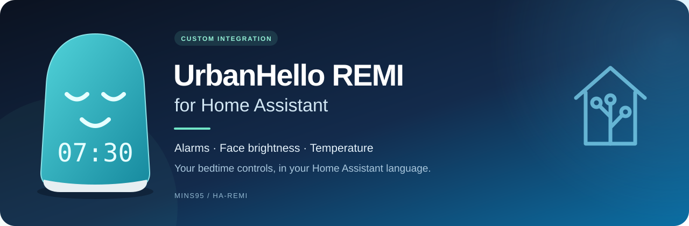
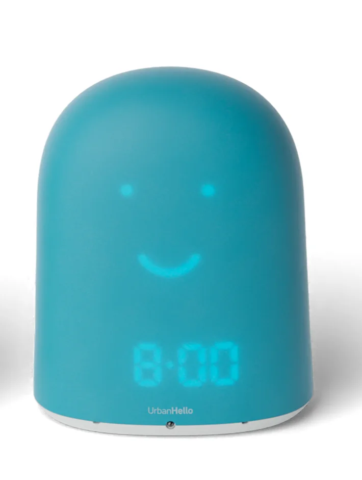

<p align="center">
  
</p>

<h1 align="center">UrbanHello REMI for Home Assistant</h1>

<p align="center">
  <a href="https://www.home-assistant.io/"></a>
  <a href="https://my.home-assistant.io/redirect/marketplace_repository/?owner=Mins95&amp;repository=ha-remi&amp;category=integration"></a>
  <a href="https://github.com/Mins95/ha-remi/releases/latest"></a>
</p>

<p align="center">
  <a href="LICENSE"></a>
  <a href="https://github.com/Mins95/ha-remi/stargazers"></a>
  <a href="https://github.com/Mins95/ha-remi/commits/main"></a>
  <a href="https://github.com/Mins95/ha-remi"></a>
  <a href="https://github.com/Mins95/ha-remi/issues"></a>
  <a href="https://github.com/Mins95/ha-remi/pulls"></a>
</p>

<p align="center">
  <a href="https://github.com/Mins95/ha-remi/actions/workflows/tests.yml"></a>
  <a href="https://github.com/Mins95/ha-remi/actions/workflows/hassfest.yml"></a>
  <a href="https://github.com/Mins95/ha-remi/actions/workflows/hacs.yml"></a>
  <a href="https://github.com/Mins95/ha-remi/actions/workflows/release.yml"></a>
</p>

<p align="center">
  Alarms, clock faces, brightness and temperature for your UrbanHello REMI.<br>
  Manage everyday settings from Home Assistant, with an English or French interface.
</p>

<p align="center">
  <br>
  <sub>Product photo © <a href="https://www.urbanhello.com/fr/">UrbanHello</a> · <a href="https://www.urbanhello.com/img/cms/UH-REMI-Bleu-Simple.webp">Original image</a></sub>
</p>

Community integration maintained by [Mins95](https://github.com/Mins95), based on [timoa/ha-remi](https://github.com/timoa/ha-remi). It uses your UrbanHello account and requires an internet connection. It is not affiliated with or endorsed by UrbanHello.

---

## 📖 Documentation

[Install and configure](#-installation) · [Entities and controls](#-entities-and-controls) · [Alarm actions](docs/usage.md#alarm-actions) · [Upgrade guide](docs/usage.md#upgrading) · [Changelog](CHANGELOG.md)

**Version 0.4.0 adds English and French interface translations.** Entity names, settings, action descriptions and supported state labels follow your Home Assistant language. Your custom entity names and alarm names are preserved.

**Upgrading from 0.3.x or the original integration?** Read the [0.4.0 migration notice](#-upgrading-to-040) before updating automations that compare face states or select music modes.

## ✨ Features

- 🌡️ **Temperature with decimals**, corrected conversion and diagnostic attributes.
- ⏰ **Alarm switches and time controls**, plus actions to create, edit and delete schedules.
- 🙂 **Clock face and time format**, with 12-hour and 24-hour display settings.
- 💡 **Two separate brightness controls:** upper light from 0 to 100, and night face brightness from 1 to 10.
- 🔊 **Volume, sound notification threshold and music playback mode.**
- 🎨 **Official app background color**, exposed as an RGB light entity.
- 🔎 **Connection and firmware information**, with a read-only firmware check button.
- 🇬🇧 🇫🇷 **English and French interface**, including translated display labels and errors.

The integration polls the UrbanHello cloud every 60 seconds. Successful commands request a refresh. Transient read failures have bounded retries; commands are not automatically replayed after an ambiguous connection failure.

## 📥 Installation

You need a REMI already configured in the official app, its UrbanHello account credentials, and internet access from Home Assistant. Installation has been checked on Home Assistant 2026.11.0; the automated test environment is described in the [changelog](CHANGELOG.md).

### Home Assistant 2026.11 and newer: Marketplace

[](https://my.home-assistant.io/redirect/marketplace_repository/?owner=Mins95&repository=ha-remi&category=integration)

1. Open **Settings → Marketplace → Add from link**.
2. Enter `https://github.com/Mins95/ha-remi`.
3. Connect your GitHub account if Marketplace requests it for custom repositories.
4. Open **Remi (Mins95)** and install the latest published release.
5. Restart Home Assistant, then continue with configuration below.

See the [official Marketplace instructions](https://www.home-assistant.io/integrations/marketplace/#custom-repositories).

### Older installations using HACS

[](https://my.home-assistant.io/redirect/hacs_repository/?owner=Mins95&repository=ha-remi&category=integration)

Add `https://github.com/Mins95/ha-remi` under **Custom repositories**, choose **Integration**, install the published release and restart Home Assistant.

### Configure REMI

1. Open **Settings → Devices & services → Add integration**.
2. Search for **Remi**.
3. Enter the username and password used in the UrbanHello app.
4. Select the REMI to configure if your account contains several devices.

For a manual installation, download the source from [Releases](https://github.com/Mins95/ha-remi/releases), copy `custom_components/urbanhello_remi_unofficial/` into Home Assistant's `config/custom_components/` directory, then restart.

> [!IMPORTANT]
> **Already using another REMI repository?** Both forks use the domain `urbanhello_remi_unofficial`. Marketplace cannot install two repositories providing that domain. **Delete and uninstall also removes the configured integration, devices and entities**; it is not a repository-switch action. Preserve your existing configuration when changing the code source. See [existing installations](docs/usage.md#existing-installations-and-repository-changes).

## 🎛️ Entities and controls

The table uses English display names. Entity names follow Home Assistant's configured language and refresh when the integration reloads; menus and state labels follow your interface language. French and English are included. Entity IDs depend on your installation; existing IDs and user-assigned names are preserved during ordinary updates.

| Control | Entity type | Purpose |
| --- | --- | --- |
| Clock face | Select | Off, awake, sleepy, semi-awake or smiley |
| Clock format | Select | 12-hour or 24-hour display |
| Music mode | Select | Normal, single track, repeat track or repeat playlist |
| Volume | Number | Speaker volume, **0–100** |
| Brightness | Number | Upper light, **0–100**; `0` turns it off |
| Night face brightness | Number | Face brightness in darkness, **1–10** |
| Noise alert threshold | Number | Sound notification threshold, **0–250** |
| App background color | RGB light | REMI's background color in the official app |
| Each alarm | Switch | Enable or disable that schedule |
| Each alarm time | Time | Set hours and minutes in REMI's time zone |

**Night face brightness** matches the scale in the [manufacturer's guide](https://www.urbanhello.com/fr/faq/faqs/gerer-la-luminosite-de-remi). It is independent of the upper light. The RGB entity changes the app's appearance; it does not control a physical multicolor light.

**Music mode** changes repeat behavior. It does not choose a track or start playback.

| Information | Entity type | Purpose |
| --- | --- | --- |
| Temperature | Sensor | Degrees Celsius, retaining decimal values |
| Current face | Sensor | Reported clock face |
| Firmware version | Sensor | Installed firmware |
| Online / Alive | Binary sensors | Connection and activity reported by REMI |
| Firmware update available | Binary sensor | Update indication or target assigned to this device |
| Check firmware status | Button | Refresh firmware information; **does not install an update** |
| Wi-Fi signal | Sensor | RSSI in dBm; disabled by default |
| IP address | Sensor | Reported address; disabled by default |

A missing or invalid measurement stays unknown. The firmware server's default version alone does not trigger an update alert. Firmware installation remains managed by UrbanHello; see the [manufacturer's update instructions](https://www.urbanhello.com/fr/faq/faqs/comment-mettre-a-jour-remi-manuellement-).

## ⏰ Alarm actions

Use the alarm switch and time entity for everyday adjustments. For automation, three actions are available:

| Action | Required fields | Optional fields |
| --- | --- | --- |
| `urbanhello_remi_unofficial.create_alarm` | `name`, `time` | `enabled`, `repeat`, `face_define`, `volume` |
| `urbanhello_remi_unofficial.update_alarm` | `event_id` | `name`, `time`, `enabled`, `repeat`, `face_define`, `volume` |
| `urbanhello_remi_unofficial.delete_alarm` | `event_id` | — |

Times use `HH:MM` or `HH:MM:00` in REMI's time zone. The service's repeat convention remains **Sunday = 0, Monday = 1, …, Saturday = 6**. The app's weekly display starts on Monday; the integration handles the conversion.

```yaml
action: urbanhello_remi_unofficial.create_alarm
data:
  name: Weekday morning
  time: "07:30"
  enabled: true
  repeat: [1, 2, 3, 4, 5]
  face_define: awake
  volume: 40
```

Creation currently requires exactly one loaded REMI. Updating or deleting an alarm locates its device from `event_id`, available in the alarm time entity's attributes. See the [full action reference and examples](docs/usage.md#alarm-actions).

## 🔄 Upgrading to 0.4.0

Display labels now follow your Home Assistant language. **Raw face states and music options change to language-independent codes.** Update YAML, templates and state conditions that used the old English values:

| Before | From 0.4.0 |
| --- | --- |
| `Awake` / `Sleepy` | `awake` / `sleepy` |
| `Semi-Awake` | `semi_awake` |
| `Single track` | `single_track` |
| `Repeat playlist` | `repeat_playlist` |

The [complete mapping](docs/usage.md#040-translated-interface-and-stable-state-codes) also covers `Off`, `Smiley`, `Normal`, `Repeat track` and alarm attributes. Use the codes in automations, **not translated display labels**. The `face_define` alarm action's existing `FACE_*` constants remain supported.

This update preserves the integration domain, entity unique IDs and custom names. Automations are not rewritten automatically. Earlier releases also corrected temperature conversion, music modes and brightness entities; review [previous migrations](docs/usage.md#earlier-entity-and-behavior-changes) when upgrading from an older version.

## 🛠️ Troubleshooting and limitations

- **Cloud unavailable or expired login:** check your internet connection and reauthenticate the integration when requested. The selected REMI is retained.
- **Unexpected temperature change after updating:** the corrected conversion is `(raw - 50) / 5`; `160` means `22.0 °C`. Old history is not rewritten. Decimal display does not establish the sensor's physical accuracy.
- **Firmware alert without an install action:** the integration only reads the update status and refreshes it. It cannot install firmware.
- **An automation stopped selecting a face or music mode:** apply the [0.4.0 state mapping](docs/usage.md#040-translated-interface-and-stable-state-codes).
- **A previous brightness or Night Light entity disappeared:** see the [entity migration guide](docs/usage.md#earlier-entity-and-behavior-changes).

The cloud API may change independently of this integration. Alarm writes are covered by simulated API tests; the recorded installation check did not change the physical device's schedules. Night face brightness is implemented and tested at the API level, but its physical effect has not yet been verified with this fork. This integration does not provide baby monitor audio or music playback controls.

[Usage and migration guide](docs/usage.md) · [Protocol observations](docs/protocol-3.4.23.json) · [Changelog](CHANGELOG.md) · [Report an issue](https://github.com/Mins95/ha-remi/issues)

## 🤝 Development and credits

Contributions should target `main` in [Mins95/ha-remi](https://github.com/Mins95/ha-remi). Use Python 3.14, install `requirements-test.txt`, then run:

```sh
pytest --cov --cov-report=term-missing
```

GitHub Actions runs the test suite, Hassfest and HACS validation. The Release workflow checks the requested version against the manifest and changelog and runs the tests before publishing.

Thanks to [timoa](https://github.com/timoa/ha-remi) and the original contributors, and to [pdruart](https://github.com/pdruart/Remi_UrbanHello_hass) for earlier work on REMI alarms and brightness. The product photo belongs to [UrbanHello](https://www.urbanhello.com/fr/).

Community maintained and distributed under the [MIT License](LICENSE).
